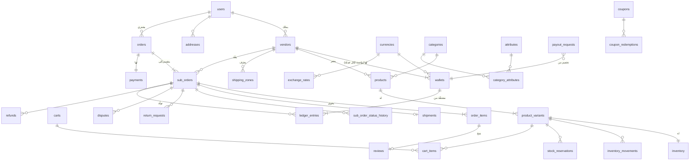

# نموذج البيانات — ERD

> المرحلة 01 · منصة بسطة · PostgreSQL 16 + Prisma · **مراجعة 2**

> **ما تغيّر في المراجعة 2:** حُذفت جداول الاشتراكات الثلاثة (ADR-009 ملغى) · أُضيف `stock_reservations` (ADR-006) · أُضيف `currencies` و `exchange_rates` والمحفظة صارت بمفتاح مركّب (ADR-013).

## اصطلاحات ملزمة

| الاصطلاح | القاعدة |
|----------|---------|
| المفاتيح | `UUID v7` — قابل للفرز زمنياً، ولا يكشف حجم الأعمال كما يفعل المتسلسل |
| المال | `BIGINT` بأصغر وحدة عملة، اسم الحقل ينتهي بـ `_minor` |
| العملة | **كل حقل `_minor` يرافقه حقل عملة أو ينتمي لصف يحمل واحدة.** لا مبلغ بلا عملة معروفة |
| النسب | `INT` بـ basis points، ينتهي بـ `_bps` (12.5% = 1250) |
| الوقت | `TIMESTAMPTZ` بتوقيت UTC حصراً |
| النصوص ثنائية اللغة | حقلان `_ar` و `_en`، لا JSON |
| الحذف | `deleted_at` منطقي على كيانات المستخدم؛ **لا حذف منطقي ولا فعلي على أي جدول مالي** |
| اللقطات | كل حقل ينتهي بـ `_snapshot` منسوخ وقت الحدث ولا يُحدَّث بعده أبداً |

---

## المخطط العام



---

## 1 · الهوية والصلاحيات

**`users`**
`id` · `email` (فريد) · `phone` (فريد) · `password_hash` · `full_name` · `locale` (ar/en) · `status` (active/suspended/deleted) · `email_verified_at` · `phone_verified_at` · `totp_secret_encrypted` · `totp_enabled_at` · `last_login_at` · `deleted_at` · `created_at`

**`user_roles`** — `user_id` · `role` (customer/vendor_owner/vendor_staff/admin) · `granted_at` · `granted_by`
> مستخدم واحد قد يحمل أكثر من دور. عميل يفتح متجراً لا يُنشأ له حساب ثانٍ.

**`admin_permissions`** — `user_id` · `permission` (سلسلة نقطية: `vendors.approve`, `payouts.approve`, `commissions.edit`, `disputes.resolve`, `refunds.issue`) · `granted_by` · `granted_at`

**`refresh_tokens`** — `id` · `user_id` · `token_hash` · `family_id` · `expires_at` · `revoked_at` · `replaced_by_id` · `user_agent` · `ip`
> `family_id` يكشف إعادة استخدام رمز مسروق: استخدام رمز مُبطَل يُبطل العائلة كلها فوراً.

**`otp_codes`** — `id` · `user_id` · `channel` (sms/email) · `purpose` · `code_hash` · `attempts` · `expires_at` · `consumed_at`

**`audit_logs`** — `id` · `actor_user_id` · `actor_role` · `action` · `entity_type` · `entity_id` · `before_json` · `after_json` · `ip` · `user_agent` · `created_at`
> للإضافة فقط. كل عملية إدارية أو مالية تكتب سطراً هنا.

---

## 2 · البائعون والاشتراكات

**`vendors`**
`id` · `owner_user_id` · `slug` (فريد) · `name_ar` · `name_en` · `logo_key` · `cover_key` · `description_ar` · `description_en` · `status` (pending/approved/suspended/banned) · `rejection_reason` · **`settlement_currency`** · **`country`** · `shipping_policy_ar/en` · `return_policy_ar/en` · `rating_avg` · `rating_count` · `approved_at` · `approved_by` · `created_at`
> `settlement_currency` هي عملة تسعير البائع وتحصيل مستحقاته معاً (ADR-013). تغييرها بعد أول بيع ممنوع — تحتاج محفظة جديدة وتسوية القديمة.

**`vendor_documents`** — `id` · `vendor_id` · `type` (commercial_register/national_id/tax_card/bank_proof) · `file_key` · `status` (pending/approved/rejected) · `reject_reason` · `reviewed_by` · `reviewed_at`

**`vendor_bank_accounts`** — `id` · `vendor_id` · `holder_name` · `iban` · `bank_name` · `swift` · `is_default` · `verified_at`

> **الاشتراكات محذوفة.** جداول `plans` و`vendor_subscriptions` و`subscription_invoices` أُلغيت بإلغاء ADR-009. مصدر الإيراد الوحيد هو العمولة.

---

## 2ب · العملات وأسعار الصرف *(ADR-013)*

**`currencies`**
`code` (مفتاح أساسي، ISO 4217) · `name_ar/en` · `symbol` · **`minor_unit_digits`** · `rounding_step_minor` · `min_payout_minor` · `is_active` · `is_base` · `sort`

```
قيم مؤسِّسة — لاحظ اختلاف الخانات:
  USD  دولار     $     2   min_payout  5000     (50.00)
  EUR  يورو      €     2   min_payout  4500     (45.00)
  SAR  ريال      ﷼     2   min_payout 18750    (187.50)
  AED  درهم      د.إ   2   min_payout 18000    (180.00)
  EGP  جنيه      ج.م   2   min_payout 240000  (2400.00)
  JOD  دينار     د.أ   3 ← min_payout 35000     (35.000)
  KWD  دينار     د.ك   3 ← min_payout 15000     (15.000)
```
> **`minor_unit_digits` ليس حقلاً تجميلياً.** `50000` تعني 500.00 دولاراً و**50.000 ديناراً**. أي كود يضرب في 100 ثابتاً ينتج خطأً بعشرة أضعاف في الدينار. التحويل يمرّ بدالة واحدة تقرأ هذا الحقل.
> `min_payout_minor` هنا يحسم Q-05: ما يعادل 50 دولاراً تقريباً بكل عملة، لا رقم واحد مشترك.

**`exchange_rates`** — للإضافة فقط
`id` · `base_code` · `quote_code` · `rate` (`NUMERIC(20,10)`) · `source` · `effective_at` · `fetched_at`
> **الجدول الوحيد في النظام الذي يحمل نوعاً عشرياً** — لأنه معامل تحويل لا مبلغ. ناتج الضرب يُقرَّب فوراً إلى عدد صحيح بأصغر وحدة العملة الهدف. لا يُخزَّن مبلغ عشري أبداً (ADR-001).
> السعر لا يُحدَّث بل يُضاف صفّاً جديداً، فيبقى تفسير أي تحويل تاريخي ممكناً.

---

## 3 · الكتالوج

**`categories`** — `id` · `parent_id` · `path` (مادّي: `/3/17/42/`) · `depth` · `slug` · `name_ar/en` · `icon_key` · `sort` · `is_active`
> `path` المادّي يجعل استعلام "كل منتجات فرع الفئة" استعلاماً واحداً بـ `LIKE '/3/%'` بلا تكرار.

**`attributes`** — `id` · `code` · `name_ar/en` · `input_type` (select/multiselect/number/text/boolean) · `unit` · `is_filterable` · `is_variant_axis` · `sort`
**`attribute_values`** — `id` · `attribute_id` · `value_ar/en` · `hex_color` · `sort`
**`category_attributes`** — `category_id` · `attribute_id` · `is_required` · `sort`

**`brands`** — `id` · `slug` · `name_ar/en` · `logo_key`

**`products`**
`id` · `vendor_id` · `category_id` · `brand_id` · `slug` · `name_ar/en` · `description_ar/en` · `status` (draft/pending_review/active/rejected/archived) · `reject_reason` · `has_variants` · `rating_avg` · `rating_count` · `sold_count` · `published_at` · `deleted_at`
> لا سعر على المنتج. السعر يعيش على المتغيّر حصراً — منتج بلا متغيرات يحمل متغيّراً افتراضياً واحداً. هذا يلغي فرعين متوازيين في كل كود تسعير.

**`product_variants`** — `id` · `product_id` · `sku` (فريد لكل بائع) · `price_minor` · `compare_at_price_minor` · `barcode` · `weight_grams` · `length_mm` · `width_mm` · `height_mm` · `is_active`
**`variant_option_values`** — `variant_id` · `attribute_id` · `attribute_value_id`
> قيد فريد مركّب يمنع تكرار التركيبة نفسها داخل المنتج الواحد.

**`product_attribute_values`** — `product_id` · `attribute_id` · `attribute_value_id` | `value_text_ar/en` | `value_number` | `value_boolean`
**`product_images`** — `id` · `product_id` · `variant_id` · `file_key` · `alt_ar/en` · `width` · `height` · `sort`

**`inventory`** *(ADR-006)*
`variant_id` (مفتاح أساسي) · `on_hand` · `reserved` · `low_stock_threshold` · `backorder_allowed` · `version` · `updated_at`
> **المتاح = `on_hand - reserved`**، حقل محسوب لا مخزَّن.
> قيود على مستوى قاعدة البيانات: `on_hand >= 0` و `reserved >= 0` و `reserved <= on_hand`.
> `reserved` **إسقاط** لمجموع الحجوزات النشطة، لا رقم يُحرَّك يدوياً — يُدقَّق ليلياً ضد `stock_reservations`.

**`stock_reservations`** *(ADR-006 — جديد في المراجعة 2)*
`id` · `variant_id` · `cart_id` · `order_id` · `qty` · `status` (active/committed/released/expired) · `expires_at` · `committed_at` · `released_at` · `created_at`
> **السلة لا تحجز.** الصف يُنشأ لحظة دخول صفحة الدفع بـ `expires_at = now + settings.reservation_ttl_minutes` (15 دقيقة).
> `active → committed` عند نجاح الدفع · `active → expired` بمهمة كل دقيقة · `active → released` عند الإلغاء أو فشل الدفع.
> فهرس جزئي على `(expires_at) WHERE status = 'active'` يجعل مهمة التحرير استعلاماً واحداً رخيصاً.

**`inventory_movements`** — `id` · `variant_id` · `delta` · `reason` (sale/return/cancel/manual_adjust/import/damage) · `ref_type` · `ref_id` · `actor_user_id` · `note` · `created_at`
> للإضافة فقط. مجموع `delta` يجب أن يساوي `on_hand` — ثابت يُفحص ليلياً.

---

## 4 · السلة

**`carts`** — `id` · `user_id` · `session_token` · `currency` · `coupon_code` · `expires_at` · `updated_at`
**`cart_items`** — `id` · `cart_id` · `variant_id` · `vendor_id` · `qty` · `price_minor_at_add` · `added_at`
> `vendor_id` مكرر هنا عمداً لتجميع السلة حسب البائع بلا ربط إضافي.
> `price_minor_at_add` للمقارنة والتنبيه فقط: **السعر النافذ هو سعر لحظة الطلب**، ويُعرض تنبيه واضح إن تغيّر.
> **السلة لا تمسّ المخزون** — الحجز يبدأ عند دخول صفحة الدفع (ADR-006).
> السلة قد تضمّ بائعين بعملات مختلفة؛ `carts.currency` هي عملة عرض المشتري، والتحويل للعرض فقط (ADR-013).

---

## 5 · الطلبات

**`orders`** — الطلب الأب
`id` · `order_number` (بشري، فريد) · `customer_user_id` · `guest_email` · `guest_phone` · `idempotency_key` (فريد) · `currency` · `items_subtotal_minor` · `shipping_total_minor` · `discount_total_minor` · `tax_total_minor` · `grand_total_minor` · `status` · `shipping_address_snapshot` (JSONB) · `billing_address_snapshot` (JSONB) · `customer_note` · `placed_at` · `canceled_at`
> العنوان **لقطة** لا مرجع. تعديل المشتري لعنوانه لاحقاً لا يغيّر عنوان طلب سابق.

**`sub_orders`** — الطلب الفرعي، وحدة التنفيذ الحقيقية
`id` · `order_id` · `vendor_id` · `sub_order_number` · **`settlement_currency`** · **`fx_rate_snapshot`** · `items_subtotal_minor` · `shipping_minor` · `discount_minor` · `tax_minor` · `total_minor` · `commission_rate_bps_snapshot` · `commission_minor` · `vendor_net_minor` · `status` · `placed_at` · `accepted_at` · `shipped_at` · `delivered_at` · `hold_release_at` · `completed_at` · `canceled_at` · `cancel_reason`
> **كل مبالغ هذا الجدول بعملة البائع** (`settlement_currency`)، لا بعملة تحصيل المشتري.
> `fx_rate_snapshot` هو سعر الصرف من `orders.currency` إلى `settlement_currency` **لحظة الطلب**. تحديث السعر غداً لا يغيّر مستحقات طلب اليوم بفلس (ADR-013).
> `hold_release_at = delivered_at + settings.hold_period_days` — ADR-007.
> `vendor_net_minor = items_subtotal − discount − commission + shipping` (الشحن يمرّ كاملاً للبائع بلا عمولة — ADR-008).

**`order_items`**
`id` · `sub_order_id` · `order_id` · `vendor_id` · `variant_id` · `product_id` · `product_name_snapshot_ar/en` · `variant_label_snapshot` · `sku_snapshot` · `image_key_snapshot` · `unit_price_minor` · `qty` · `line_subtotal_minor` · `line_discount_minor` · `line_tax_minor` · `line_total_minor` · `commission_bps_snapshot` · `commission_minor` · `refunded_qty`
> كل لقطة هنا تضمن أن فاتورة قديمة تُعرض كما كانت، ولو حُذف المنتج أو تغيّر اسمه.

**`sub_order_status_history`** — `id` · `sub_order_id` · `from_status` · `to_status` · `actor_user_id` · `actor_role` · `reason` · `created_at`

**`addresses`** — `id` · `user_id` · `label` · `country` · `region` · `city` · `area` · `street` · `building` · `floor` · `landmark` · `lat` · `lng` · `recipient_name` · `phone` · `is_default` · `deleted_at`

---

## 6 · الشحن *(بمسؤولية البائع — ADR-008)*

**`shipping_zones`** — `id` · `vendor_id` · `name_ar/en` · `is_active`
**`shipping_zone_regions`** — `zone_id` · `country` · `region` · `city`
**`shipping_rates`** — `id` · `zone_id` · `method` (flat/by_weight/free_over) · `price_minor` · `per_kg_minor` · `free_over_minor` · `min_days` · `max_days` · `is_active`
**`shipments`** — `id` · `sub_order_id` · `carrier_code` · `tracking_number` · `label_url` · `status` · `shipped_at` · `delivered_at`
**`shipment_events`** — `id` · `shipment_id` · `code` · `description_ar/en` · `location` · `occurred_at`

---

## 7 · الخصومات

**`coupons`**
`id` · `code` (فريد) · `scope` (platform/vendor) · `vendor_id` · `type` (percent/fixed/free_shipping) · `value_bps_or_minor` · `max_discount_minor` · `min_order_minor` · `usage_limit_total` · `usage_limit_per_user` · `used_count` · `funded_by` (platform/vendor) · `starts_at` · `ends_at` · `is_active`
> **`funded_by` هو الحقل الحاسم:** يحدد من يتحمّل الخصم. كوبون تموّله المنصة لا ينقص مستحقات البائع؛ كوبون يموّله البائع ينقصها. إغفاله يعني نزاعاً مع كل بائع.

**`coupon_conditions`** — `coupon_id` · `condition_type` (category/product/vendor/first_order) · `ref_id`
**`coupon_redemptions`** — `id` · `coupon_id` · `order_id` · `user_id` · `discount_minor` · `created_at`
> قيد فريد على `(coupon_id, user_id)` عند تفعيل حد الاستخدام لكل مستخدم.

**`tax_rates`** — `id` · `country` · `region` · `rate_bps` · `is_price_inclusive` · `effective_from` · `effective_to`

---

## 8 · الدفع

**`payments`** — `id` · `order_id` · `provider` · `provider_intent_id` · `amount_minor` · `currency` · `method` (card/wallet/cod) · `status` (pending/requires_action/authorized/captured/failed/voided) · `authorized_at` · `captured_at` · `failure_code` · `failure_message`
**`payment_events`** — `id` · `payment_id` · `provider` · `provider_event_id` · `type` · `payload_json` · `processed_at` · `received_at`
> **قيد فريد على `(provider, provider_event_id)`** — هذا القيد وحده هو ما يمنع طلباً مكرراً عند وصول الإشعار مرتين (ADR-011).

**`refunds`** — `id` · `sub_order_id` · `payment_id` · `amount_minor` · `reason` · `status` (pending/succeeded/failed) · `provider_refund_id` · `requested_by` · `approved_by` · `ledger_entry_id` · `created_at`

---

## 9 · المال — النواة الحرجة *(ADR-005)*

**`commission_rules`**
`id` · `scope` (global/category/vendor) · `category_id` · `vendor_id` · `rate_bps` · `min_fee_minor` · `max_fee_minor` · `effective_from` · `effective_to` · `created_by` · `created_at`
> لا تُحذف قاعدة أبداً — تُنهى صلاحيتها بـ `effective_to` فقط، ليبقى تفسير أي عمولة تاريخية ممكناً.

**`wallets`** — `id` · `vendor_id` · `currency` · `balance_pending_minor` · `balance_available_minor` · `balance_withdrawn_minor` · `version` · `updated_at`
> **المفتاح الفريد مركّب: `(vendor_id, currency)`** — محفظة لكل عملة، ولا يُجمع رصيدان بعملتين في رقم واحد أبداً (ADR-013).
> **إسقاط محسوب لا مصدر حقيقة.** يُقفل بـ `SELECT ... FOR UPDATE` في كل معاملة تمسّه.

**`ledger_entries`** — **مصدر الحقيقة المالي الوحيد**
`id` · `wallet_id` · `vendor_id` · **`currency`** · `entry_type` · `direction` (credit/debit) · `amount_minor` · `bucket` (pending/available) · `ref_type` · `ref_id` · `reverses_entry_id` · `memo` · `created_by` · `created_at`

أنواع القيود:

| `entry_type` | الاتجاه | الجيب | المُطلِق |
|--------------|---------|-------|----------|
| `sale_credit` | دائن | pending | نجاح الدفع |
| `commission_debit` | مدين | pending | نجاح الدفع |
| `shipping_credit` | دائن | pending | نجاح الدفع |
| `hold_release_out` | مدين | pending | مهمة يومية بعد 14 يوماً |
| `hold_release_in` | دائن | available | القيد المقابل، بالمعاملة نفسها |
| `refund_debit` | مدين | pending أو available | استرداد |
| `payout_debit` | مدين | available | صرف طلب سحب |
| `adjustment_credit` / `adjustment_debit` | كلاهما | حسب الحالة | تصحيح إداري موثّق |

> `subscription_fee_debit` **محذوف** بإلغاء ADR-009.
> `currency` على كل قيد فائض عن `wallet_id` عمداً: يجعل أي استعلام تجميعي يفشل صراحةً إن نسي التجميع حسب العملة، بدل أن يجمع تفاحاً وبرتقالاً بصمت.

**الثوابت الملزمة — تُفحص آلياً كل ليلة، وكلها مجمَّعة حسب العملة:**
```
1. balance_pending_minor   = Σ(amount × ±1) حيث bucket = pending    لكل (محفظة، عملة)
2. balance_available_minor = Σ(amount × ±1) حيث bucket = available  لكل (محفظة، عملة)
3. Σ(sale_credit − commission_debit − refund_debit + shipping_credit)
   = Σ(مستحقات البائعين)                                            لكل عملة على حدة
4. أي `UPDATE` أو `DELETE` على الجدول يُرفض بمشغّل قاعدة بيانات
5. لا قيد واحد يجمع عملتين، ولا استعلام تجميعي بلا GROUP BY currency
```

**`payout_requests`** — `id` · `vendor_id` · `wallet_id` · `amount_minor` · `status` (requested/approved/processing/paid/rejected) · `bank_account_snapshot_json` · `ledger_entry_id` · `requested_at` · `approved_by` · `approved_at` · `paid_at` · `transfer_reference` · `reject_reason`
> بيانات البنك **لقطة**: تغيير البائع لحسابه لاحقاً لا يغيّر سجل تحويل تمّ فعلاً.

---

## 10 · المراجعات والنزاعات

**`reviews`** — `id` · `order_item_id` (**فريد**) · `product_id` · `vendor_id` · `user_id` · `rating` (1–5) · `title` · `body` · `status` (pending/published/rejected) · `reject_reason` · `created_at`
> القيد الفريد على `order_item_id` هو ما يجعل كل مراجعة موثّقة بشراء فعلي — لا حقل `is_verified` يُضبط يدوياً.

**`review_media`** · **`review_replies`** (رد البائع)

**`return_requests`** — `id` · `sub_order_id` · `items_json` · `reason_code` · `description` · `media_keys` · `status` (requested/approved/rejected/in_transit/received/refunded) · `requested_at` · `resolved_by` · `resolved_at`
**`disputes`** — `id` · `sub_order_id` · `opened_by_user_id` · `against` (vendor/customer) · `reason_code` · `status` (open/vendor_responded/escalated/resolved) · `resolution` · `resolved_by` · `closed_at`
> **نزاع مفتوح يجمّد `hold_release_at`** — ADR-007.
**`dispute_messages`** — `id` · `dispute_id` · `sender_user_id` · `sender_role` · `body` · `attachments` · `created_at`

---

## 11 · المنصة

**`settings`** — `key` · `value_json` · `updated_by` · `updated_at`
القيم المؤسِّسة:
```
hold_period_days            = 14      ← ADR-007
return_window_days          = 14      ← Q-08، مساوية لفترة التعليق ومرتبطة بها
default_commission_bps      = 1000    ← Q-01، 10% عامة قبل قواعد الفئات
vendor_accept_timeout_hours = 48      ← Q-07، ثم إلغاء آلي واسترداد كامل
reservation_ttl_minutes     = 15      ← ADR-006
cart_expiry_hours           = 168
payment_reconcile_minutes   = 10
base_currency               = USD     ← ADR-013، عملة المحاسبة والتقارير الموحّدة
fx_spread_bps               = 0       ← ADR-013، مؤجَّل للمرحلة 10
coupon_default_funded_by    = platform ← Q-06
```
> **`min_payout_minor` انتقل إلى `currencies`** — لكل عملة حدّها، لا رقم واحد مشترك.
> **لا إعداد ضريبة عام** — الضريبة تتبع بلد المشتري في `tax_rates` (ADR-013، يحسم Q-04).

**`notification_templates`** — `code` · `channel` (email/sms/whatsapp/push/in_app) · `locale` · `subject` · `body` · `variables_json`
**`notifications`** — `id` · `user_id` · `channel` · `template_code` · `payload_json` · `status` · `error` · `sent_at` · `read_at`
**`push_subscriptions`** — `id` · `user_id` · `endpoint` · `keys_json` · `user_agent` · `created_at`
**`cms_pages`** · **`banners`** · **`menus`**

---

## فهارس حرجة للأداء

```sql
-- تصفّح الكتالوج
CREATE INDEX ON products (category_id, status, published_at DESC) WHERE deleted_at IS NULL;
CREATE INDEX ON products (vendor_id, status);

-- التوفّر
CREATE INDEX ON inventory (variant_id) INCLUDE (on_hand, reserved);

-- لوحة البائع
CREATE INDEX ON sub_orders (vendor_id, status, placed_at DESC);

-- مهمة تحرير الرصيد اليومية
CREATE INDEX ON sub_orders (hold_release_at)
  WHERE status = 'delivered' AND completed_at IS NULL;

-- تحرير الحجوزات المنتهية — كل دقيقة
CREATE INDEX ON stock_reservations (expires_at) WHERE status = 'active';
CREATE INDEX ON stock_reservations (cart_id) WHERE status = 'active';

-- كشف حساب البائع — لكل عملة
CREATE INDEX ON ledger_entries (vendor_id, currency, created_at DESC);
CREATE INDEX ON ledger_entries (ref_type, ref_id);

-- سعر الصرف النافذ
CREATE INDEX ON exchange_rates (base_code, quote_code, effective_at DESC);

-- عدم التكرار
CREATE UNIQUE INDEX ON payment_events (provider, provider_event_id);
CREATE UNIQUE INDEX ON orders (idempotency_key);
```
