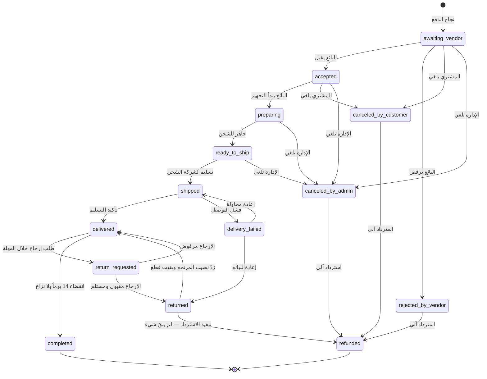
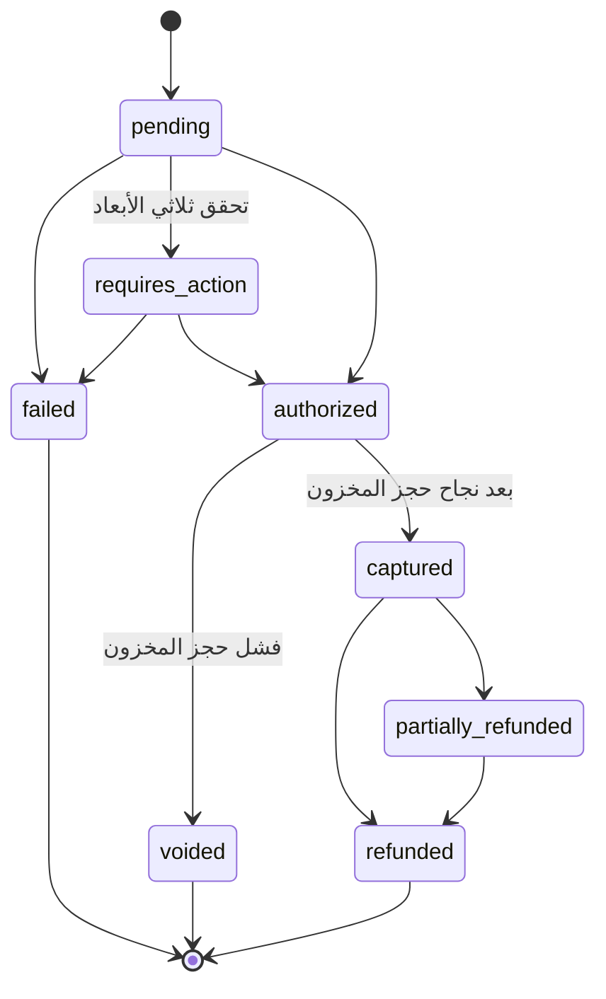
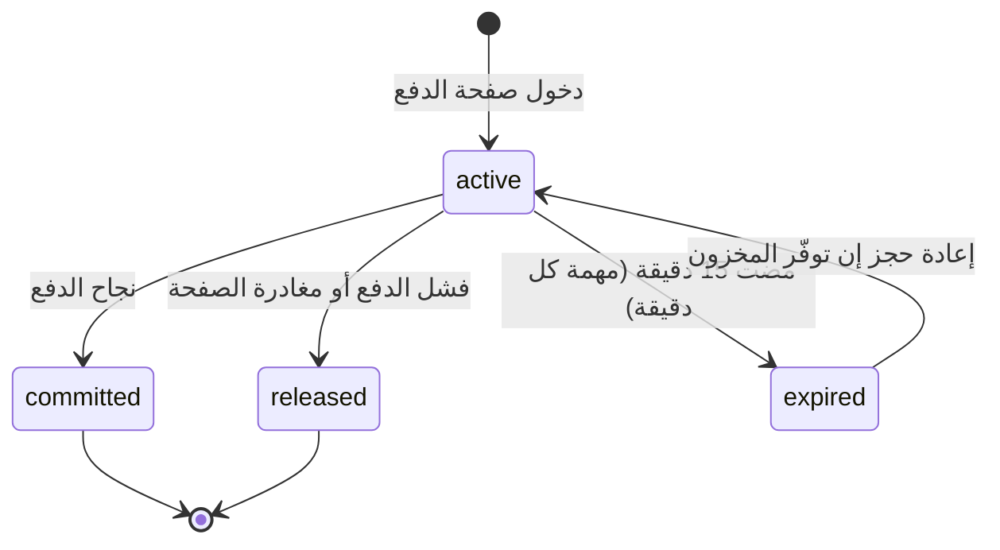

# آلات الحالات — الطلب والدفع والمال

> المرحلة 01 · منصة بسطة
> **قاعدة الإنفاذ:** كل انتقال غير مذكور في هذه الوثيقة **مرفوض على مستوى الخادم**، لا مخفيّ في الواجهة فقط. الواجهة تخفي الزر، والخادم يرفض الطلب — الاثنان معاً.

---

## 1 · حالة الطلب الفرعي `sub_orders.status`

هذه آلة الحالات الحقيقية في النظام. الطلب الأب حالته مشتقّة (القسم 2).



### جدول الانتقالات المسموحة

| من | إلى | من يملك التنفيذ | الشرط | الأثر المالي |
|----|-----|------------------|-------|---------------|
| `—` | `awaiting_vendor` | النظام | نجاح تحصيل الدفع | `sale_credit` + `commission_debit` + `shipping_credit` — كلها في جيب `pending` |
| `awaiting_vendor` | `accepted` | البائع | **خلال 48 ساعة** — بعدها إلغاء آلي واسترداد كامل (Q-07) | — |
| `awaiting_vendor` | `rejected_by_vendor` | البائع | بسبب إلزامي | عكس قيود البيع، إعادة المخزون، استرداد كامل |
| `awaiting_vendor` / `accepted` | `canceled_by_customer` | المشتري | **قبل `preparing` فقط** | عكس القيود، إعادة المخزون، استرداد كامل |
| أي حالة قبل `shipped` | `canceled_by_admin` | الإدارة | صلاحية `orders.cancel` + سبب | عكس القيود، إعادة المخزون، استرداد كامل |
| `accepted` | `preparing` | البائع | — | **نقطة اللاعودة للمشتري** |
| `preparing` | `ready_to_ship` | البائع | — | — |
| `ready_to_ship` | `shipped` | البائع | رقم تتبع إلزامي | — |
| `shipped` | `delivered` | البائع / شركة الشحن / الإدارة | — | **يُحسب `hold_release_at = now + 14 يوماً`** |
| `shipped` | `delivery_failed` | شركة الشحن / البائع | — | — |
| `delivered` | `return_requested` | المشتري | داخل مهلة الإرجاع | **تجميد `hold_release_at`** |
| `return_requested` | `returned` | البائع / الإدارة | استلام البضاعة | إعادة المخزون |
| `return_requested` | `delivered` | البائع / الإدارة | سبب رفض إلزامي | رفع التجميد، استئناف العدّ |
| `returned` | `refunded` | النظام / الإدارة | بعد خروج المال، ولم تبقَ قطعة عند المشتري | `refund_debit` + عكس العمولة |
| `returned` | `delivered` | النظام | بعد خروج المال، وبقيت قطع عند المشتري (إرجاع جزئي) | الباقي يُرجَع في مهلته من التسليم الأول، ويُكمَل ويُحرَّر رصيده بموعده — بلا إشعار تسليم ثانٍ (J-05، 19 أكتوبر 2026) |
| `delivered` | `completed` | **النظام فقط** | مضى 14 يوماً **و** لا نزاع مفتوح | `hold_release_out` + `hold_release_in` |

### انتقالات مرفوضة صراحةً — يفحصها اختبار آلي

| المحاولة | سبب الرفض |
|----------|-----------|
| `delivered` → `preparing` | لا رجوع بعد التسليم |
| `shipped` → `canceled_by_customer` | بعد الشحن لا إلغاء، بل إرجاع |
| `preparing` → `canceled_by_customer` | البائع بدأ التجهيز وتكبّد كلفة |
| `completed` → أي حالة | حالة نهائية |
| `refunded` → أي حالة | حالة نهائية |
| `awaiting_vendor` → `shipped` | تخطّي مراحل ممنوع |
| أي انتقال بفاعل خطأ | بائع لا يعلن `delivered` لطلب بائع آخر |

### قواعد ملزمة

1. **كل انتقال يكتب سطراً** في `sub_order_status_history` باسم منفّذه ودوره ووقته. لا انتقال صامت.
2. **الطلبات الفرعية مستقلة تماماً.** إلغاء طلب فرعي واحد لا يمسّ إخوته في الطلب الأب نفسه.
3. **العمولة تُعكَس مع الاسترداد** بنسبة المبلغ المسترد. استرداد نصف الطلب يعكس نصف العمولة.
4. **الانتقال يقع داخل معاملة واحدة** مع أثره المالي وأثره على المخزون. لا حالة وسطى.

---

## 2 · حالة الطلب الأب `orders.status` — مشتقّة

الطلب الأب **لا يُحدَّث يدوياً أبداً**. حالته تُحسب من أبنائه بعد كل تغيير:

| حالة الأب | القاعدة |
|-----------|---------|
| `pending_payment` | لم يُحصَّل الدفع بعد |
| `payment_failed` | فشل الدفع نهائياً |
| `processing` | فرعي واحد على الأقل قيد التنفيذ |
| `partially_completed` | بعض الفرعيات نهائية والبعض لا |
| `completed` | **كل** الفرعيات `completed` |
| `canceled` | **كل** الفرعيات ملغاة قبل الشحن |
| `refunded` | **كل** الفرعيات `refunded` |

> اشتقاق الحالة بدل تخزينها يمنع أشهر خلل في منصات الأسواق: طلب أب يقول "مكتمل" وفيه فرعي عالق منذ أسبوعين.

---

## 3 · حالة الدفع `payments.status`



### التسلسل الكامل لإتمام الشراء *(ADR-006 مراجعة 2 + ADR-011 + ADR-013)*

```
0. دخول صفحة الدفع  ← هنا يبدأ الحجز، لا قبله
     معاملة واحدة:
       SELECT ... FOR UPDATE على أسطر المخزون بترتيب variant_id تصاعدياً
         ↑ الترتيب الثابت يمنع التعطّل المتبادل بين معاملتين متزامنتين
       تحقّق: on_hand − reserved >= qty  لكل سطر
       stock_reservations: صفوف active بـ expires_at = now + 15 دقيقة
       reserved += qty
       لقطة أسعار الصرف لكل بائع بعملة مختلفة
     فشل → لا دخول لصفحة الدفع، ورسالة تسمّي المنتج الناقص تحديداً
     نجاح → عدّاد تنازلي ظاهر للمشتري

1. توليد idempotency_key
   ← إعادة إرسال بالمفتاح نفسه تُرجع الطلب الأصلي لا طلباً ثانياً

2. authorize  ← تفويض على البطاقة بلا خصم، بعملة عرض المشتري
   فشل → تحرير الحجز فوراً، لا طلب ولا خصم

3. معاملة قاعدة بيانات واحدة:
     إعادة التحقق: الحجوزات ما زالت active وغير منتهية
       منتهية والمخزون متاح  → إعادة حجز فورية ومتابعة
       منتهية والمخزون نفد   → void التفويض، لا خصم، رسالة واضحة
     إنشاء orders + sub_orders + order_items بكل اللقطات
       (سعر، عمولة، اسم، صورة، سعر صرف)
     ربط الحجوزات بـ order_id
     تسجيل حجز الكوبون
   commit

4. capture
   فشل → تحرير الحجز ، void ، الطلب payment_failed

5. عند حدث النجاح من البوابة (وهو مصدر الحقيقة):
     الحجوزات → committed
     on_hand −= qty ، reserved −= qty
     تسجيل inventory_movements
     قيود الدفتر بعملة كل بائع: sale_credit + commission_debit + shipping_credit
     كل الفرعيات → awaiting_vendor
     الإشعارات
```

**الفائدة من نقل الحجز إلى الخطوة 0:** فحص المخزون يقع قبل أن يكتب المشتري بيانات بطاقته. نافذة الخطر تنكمش من دقائق إلى ثوانٍ.

**انقطاع بين 4 و5:** مهمة تسوية كل 10 دقائق تستعلم البوابة عن كل دفعة `authorized` مضى عليها أكثر من `payment_reconcile_minutes` وتُنهيها لحالة معروفة. **لا يبقى طلب في حالة غامضة.**

**الدفع عند الاستلام:** يتخطى 2 و4. الحجز والتثبيت في معاملة واحدة، وقيود الدفتر تُسجَّل عند `delivered` لا عند الطلب.

---

### دورة حياة الحجز `stock_reservations.status`



| الانتقال | الأثر على `inventory` |
|----------|------------------------|
| `→ active` | `reserved += qty` |
| `active → committed` | `on_hand −= qty` و `reserved −= qty` |
| `active → released` | `reserved −= qty` |
| `active → expired` | `reserved −= qty` |

**قاعدتان ملزمتان:**
1. **مهمة التحرير عديمة الأثر عند التكرار.** تشغيلها مرتين على الحجز نفسه لا يخصم `reserved` مرتين — الانتقال مشروط بـ `status = 'active'` داخل المعاملة.
2. **`inventory.reserved` = مجموع الحجوزات النشطة، دائماً.** ثابت يُدقَّق ليلياً؛ أي انحراف يعني حجزاً مسرَّباً.

---

## 4 · دورة حياة المال في الطلب الفرعي

مثال ملموس — طلب بـ 100.00 ﷼، شحن 10.00، عمولة 10%:

```
اليوم 0 · تحصيل الدفع
  sale_credit        pending   +10000
  commission_debit   pending    −1000
  shipping_credit    pending    +1000
  ────────────────────────────────────
  الرصيد المعلّق              10000   (100.00)
  إيراد المنصة                 1000   (10.00)

اليوم 3 · delivered
  hold_release_at = اليوم 3 + 14 = اليوم 17
  لا قيود مالية

اليوم 17 · مهمة التحرير اليومية
  الشرط: now >= hold_release_at  و  لا نزاع مفتوح  و  الحالة delivered
  hold_release_out   pending   −10000
  hold_release_in    available +10000
  الحالة → completed
  ────────────────────────────────────
  الرصيد المتاح                10000  ← قابل للسحب الآن

اليوم 22 · طلب سحب
  الشرط: 10000 >= currencies['SAR'].min_payout_minor  (18750؟ لا)
  ← الطلب مرفوض: الرصيد دون الحد الأدنى للسحب بهذه العملة
  ← يتراكم حتى يتجاوز الحد
```
> لاحظ أن **الحد الأدنى للسحب يقرأ من `currencies`** بعملة المحفظة نفسها، لا من إعداد عام (ADR-013).

### حالة الحافة — استرداد بعد التحرير

```
اليوم 25 · نزاع محسوم لصالح المشتري، استرداد 50.00
  refund_debit       available   −5000   ← الرصيد المتاح صفر
  النتيجة: −5000  (رصيد سالب مشروع وموثّق)
  ← السحب ممنوع حتى التسوية
  ← يُخصم آلياً من أول مستحقات قادمة
  ← تنبيه للبائع وللإدارة
```

**الرصيد السالب حالة مشروعة ومصمَّمة، لا خطأ.** البديل — منع الاسترداد أو تصفير الرصيد — يخفي الالتزام ولا يلغيه.

---

## 5 · حالة البائع والاشتراك

**البائع:** `pending → approved → suspended ⇄ approved → banned`

| الحالة | يبيع؟ | يظهر في المتجر؟ | يسحب رصيده؟ |
|--------|-------|------------------|--------------|
| `pending` | لا | لا | لا |
| `approved` | نعم | نعم | نعم |
| `suspended` | لا | لا | نعم — **مستحقاته حق مكتسب**، بعد حجز احترازي 90 يوماً من التعليق (`suspension_payout_hold_days`) |
| `banned` | لا | لا | بعد تسوية النزاعات المفتوحة |

> **قاعدة غير قابلة للتفاوض:** تعليق بائع لا يصادر مستحقاته عن طلبات سلّمها فعلاً. الطلبات القائمة لبائع معلَّق **تُكمَل** ولا تُلغى — المشتري لا علاقة له بخلاف المنصة مع البائع.
>
> **الحجز الاحترازي** (صاحبة المشروع، 20 أكتوبر 2026): المعلَّق يطلب سحب رصيده بعد 90 يوماً من تعليقه، لا قبلها — ما قد يُستردّ لمشترٍ (نزاع، احتيال) يبقى في المنصة مدّته. المدة إعداد للإدارة، وتسري على المعلَّقين الآن؛ وإعادة التفعيل تنهيها.

> **آلة حالات الاشتراك محذوفة** بإلغاء ADR-009. لا اشتراكات ولا تخلّف عن سداد ولا تجميد لأسباب مالية — العمولة تُقتطع من كل عملية بيع آلياً، فلا يوجد ما يتخلّف البائع عن سداده أصلاً.

---

## 6 · ملخص الثوابت القابلة للاختبار

هذه بنود بوابة الخروج للمراحل 08 و09 و10، مكتوبة كاختبارات:

```
INV-01  Σ(sub_orders.total_minor محوَّلة بـ fx_rate_snapshot) = orders.grand_total_minor
        بسماحية فلس واحد لكل فرعي، والفارق يُقيَّد كـ fx_rounding لا يُبتلع صامتاً
INV-02  Σ(order_items.commission_minor) = sub_orders.commission_minor
INV-03  wallet.balance_* = Σ(ledger_entries)   لكل (محفظة، جيب، عملة)
INV-04  Σ(inventory_movements.delta) = inventory.on_hand          لكل متغيّر
INV-05  inventory.on_hand >= 0  و  reserved <= on_hand            دائماً
INV-06  كل sub_order في delivered له hold_release_at غير فارغ
INV-07  لا sub_order في completed وعليه نزاع مفتوح
INV-08  لا ledger_entry عُدِّل أو حُذف                             (فحص المشغّل)
INV-09  كل انتقال حالة له سطر مقابل في sub_order_status_history
INV-10  لا payment_event عولج مرتين                               (القيد الفريد)
INV-11  inventory.reserved = Σ(stock_reservations حيث status='active')  لكل متغيّر
INV-12  لا استعلام تجميعي على ledger_entries بلا GROUP BY currency
```

> **INV-11 و INV-12 جديدان في المراجعة 2.** الأول يكشف الحجوزات المسرَّبة (مخزون مجمَّد بلا سبب)، والثاني يكشف أخطر خطأ في نظام متعدد العملات: جمع مبالغ بعملات مختلفة في رقم واحد.
